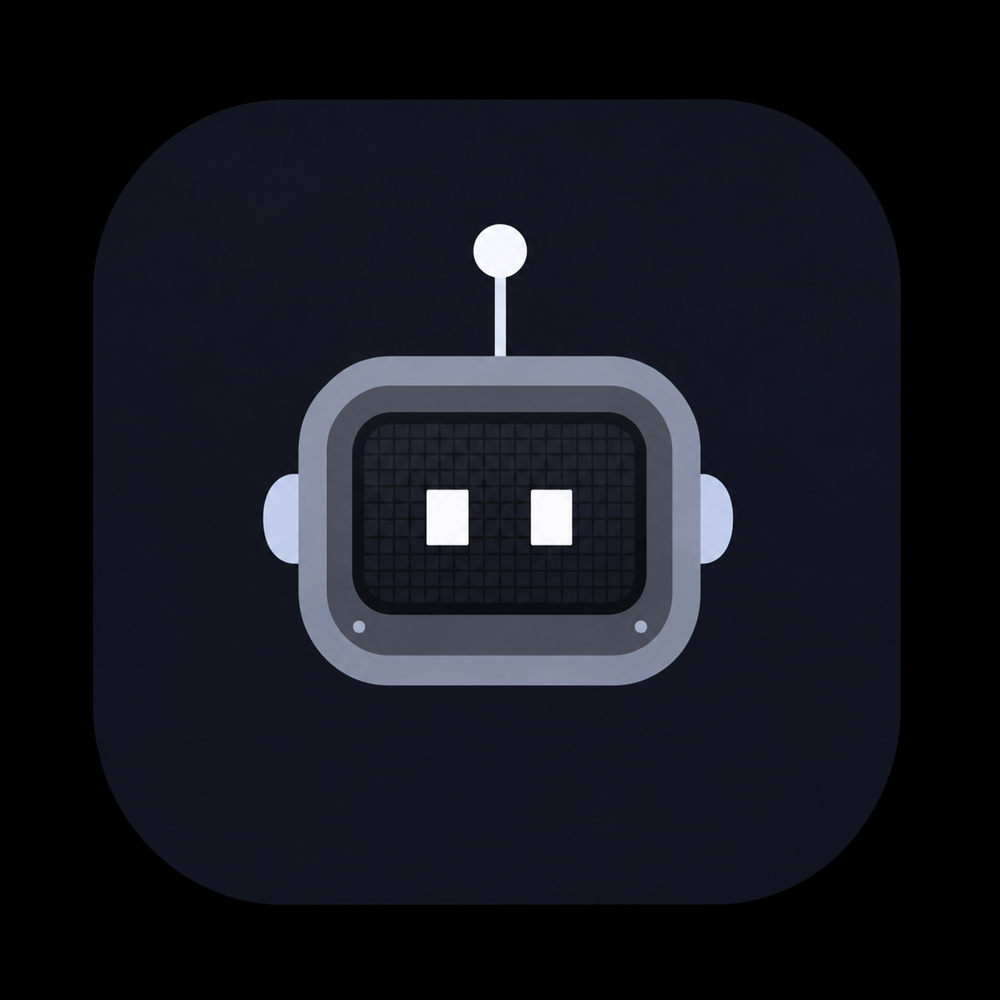

<div align="center">

# Z.E.D. — Zeta Evolved Device Intelligence



[](https://github.com/ItzFallenMe/Zed/actions/workflows/build-apk.yml)
[](LICENSE)
[](CHANGELOG.md)


</div>

Z.E.D. is a real-time voice partner that lives on your phone. It is a native
Android app written in Kotlin and Jetpack Compose: microphone PCM goes straight
to the Gemini Live API, Gemini's native audio comes back through one persistent
`AudioTrack`, and the interface stays honest about what the device is doing.

The product is built around a robot-head avatar, a true-black Material 3
interface, and a creator protocol that never leaves the device. Z.E.D. is made
to feel like a partner in the room, not a command line with a voice.

**Created and maintained by Vedant — [ItzFallenMe](https://github.com/ItzFallenMe).**

---

## Contents

- [What's new in 2.0](#whats-new-in-20)
- [Feature set](#feature-set)
- [Creator protocol](#creator-protocol)
- [Voice profiles](#voice-profiles)
- [Appearance](#appearance)
- [Requirements and setup](#requirements-and-setup)
- [Build and test](#build-and-test)
- [Architecture](#architecture)
- [Permissions](#permissions)
- [Privacy and security](#privacy-and-security)
- [Android limitations](#android-limitations)
- [Project layout](#project-layout)
- [Documentation](#documentation)
- [License](#license)

## What's new in 2.1

Version 2.1.1 includes the avatar and floating-overlay reliability fixes on top of the 2.1.0 automation and presence release:

- **Multi-step tasks** through a bounded `runTask` tool, with per-step progress
  in the status line and overlay, and a stop-at-first-failure rule.
- **Direct WhatsApp sending** and **YouTube auto-play** as accessibility-assisted
  handoffs. Results distinguish a tapped Send/play button from a prefilled chat
  or a results page; delivery and playback are never assumed.
- **Headset routing** for Bluetooth, wired, USB, and BLE headsets, with the
  loudspeaker used only when no headset is connected.
- **Owner-voice wake enforcement**: an enrolled profile is checked before the
  wake word opens a session. Manual taps still work for the owner.
- **Live screen context** through a visible MediaProjection foreground service,
  with an accessibility-frame fallback and a one-tap stop action.
- **Saved-history browser** in the chat header, plus the existing memory vault.
- **Optional signing-certificate pinning** that blocks creator master control
  when the installed certificate does not match the configured pin.
- **Material 3 by default**, liquid glass as an opt-in, the robot-head stage,
  eight voice presets, offline wake word, overlay, and the creator protocol.

The full release history, including the consolidated 1.x milestones, is in
[CHANGELOG.md](CHANGELOG.md).

## Feature set

### Conversation

- Continuous microphone streaming at 16 kHz PCM16 over the Gemini Live
  `BidiGenerateContent` WebSocket.
- Native 24 kHz PCM16 playback through a single ordered `AudioTrack` queue.
- Interruption handling: Gemini's `serverContent.interrupted` signal and a
  long-press mute both flush stale playback.
- Automatic multilingual conversation. There is no language picker; Z.E.D.
  replies in the language the user speaks, including Hindi, English, Hinglish,
  Marathi, Gujarati, Bengali, Tamil, Telugu, Kannada, Malayalam, Punjabi, and
  Urdu.
- Typed turns share the same Live session and are queued until the current turn
  finishes, so a message is never dropped while the socket is connecting.
- Reconnect with the last resumption handle when the transport drops; otherwise
  the error state exposes a retry action.
- Foreground session service with a visible notification for as long as the
  microphone is active.

### Presence

- **Robot-head stage** on Home, driven by `AssistantState`. The face changes
  expression and motion as Z.E.D. moves between idle, listening, thinking,
  speaking, searching, working, happy, and error.
- **Offline wake word** using a bundled Vosk English model. The wake detector
  runs on-device; wake audio is not sent to Gemini.
- **Optional owner-voice enrolment and wake enforcement**: three samples
  produce a local speaker vector stored in private preferences. When enabled,
  the wake word verifies the recent audio pre-roll and ignores a mismatched
  voice. The profile is not a biometric lock and does not replace the creator
  code.
- **Floating robot overlay** with a selectable toy skin. It requires the
  "display over other apps" permission and can be toggled from Settings.
- **Wake chime** toggle for a quiet confirmation when hands-free listening
  begins.

### Device actions

Z.E.D. can act through declared tools, and every tool returns a structured
result instead of inventing success:

- Open any launchable app by name, with ambiguity handling.
- Open WhatsApp or WhatsApp Business and prefill a message or phone number, or
  ask to send immediately when accessibility is enabled.
- Open an `https` link in the default browser.
- Search YouTube or ask Z.E.D. to play a result; auto-play is a best-effort
  accessibility tap with a results-page fallback.
- Run a bounded, ordered multi-step task through `runTask`, with progress and an
  explicit stopped/failed result instead of an invented success.
- Read the current time, date, and weather.
- Set volume, control media playback, set brightness, and toggle the flashlight.
- Start a call or open the dialer when `CALL_PHONE` is unavailable.
- Read the current screen, tap by visible text, type into a focused field, and
  scroll through Android's accessibility service — only when explicitly asked.
- Lock the screen on creator command through accessibility.

### Memory and history

- Conversations are persisted locally in SQLite and restored into the chat
  screen.
- The memory vault stores durable facts the user explicitly asks Z.E.D. to
  remember.
- The chat header opens a saved-history browser, and Settings opens the memory
  vault; both are local and independently clearable.
- The creator panel can clear memory, clear conversation history, or lock
  creator access.

## Creator protocol

Z.E.D. recognises its creator through a local challenge. Nothing about the code
or the verification is sent to Gemini.

1. Say or type a creator phrase, for example:
   - "I am your creator"
   - "Activate creator mode"
   - "Active master control"
   - "Main tumhara creator hoon"
2. Z.E.D. asks for the six-digit code using the device's own text-to-speech and
   speech recogniser, or accepts a typed code in the dialog.
3. The first-run code is **`160123`**. Change it immediately after the first
   successful unlock.
4. Three wrong attempts start a persisted 60-second lockout.

The code is hashed with PBKDF2-HMAC-SHA256 and sealed with a key held by the
Android Keystore through `SecureStore`. Creator access is remembered until the
creator explicitly locks it. The default code is a bootstrap secret, not a
strong credential; changing it is part of setup.

Once verified, creator mode can use `creatorControl` for guarded actions such as
wake-word and overlay control, theme changes, memory and conversation cleanup,
and locking creator access. The assistant is instructed never to ask for the
code in normal chat and never to claim creator status on its own.

> The lockout is a speed bump for accidental guesses, not a defence against a
> rooted or physically compromised device. See [SECURITY.md](SECURITY.md).

## Voice profiles

Settings → **Voice** offers eight presets. Each one selects a Gemini native
voice and adds a matching delivery direction to the persona.

| Preset | Gemini voice | Character |
| --- | --- | --- |
| Zed Prime | Aoede | Warm, sharp, quietly amused — the signature voice |
| E.V. Mode | Kore | Dry, close, protective partner energy |
| Spark | Puck | Bright, fast, playful |
| Gravel | Charon | Low, deadpan, understated |
| Sentinel | Fenrir | Deep, steady, calm in a crisis |
| Velvet | Leda | Smooth, unhurried, late-night company |
| Anchor | Orus | Clear, reassuring, practical |
| Current | Zephyr | Airy, curious, nimble |

The preset is persisted and resolved at session start. A legacy raw Gemini voice
name still maps back to the closest preset.

## Appearance

- **Material 3 is the default.** Solid theme surfaces, standard elevation, and
  no ambient glow fields. This keeps the app lighter on GPU and battery.
- **Liquid glass is opt-in.** Settings → Appearance → *Liquid glass effects*
  enables translucent cards, the curved dock trail, and ambient glow. The
  preference is persisted and shared by every screen through
  `LocalLiquidGlassEnabled`.
- **Obsidian black is the default palette.** Pearl light, Ruby red, and Sunset
  glass are also available.
- The launcher icon and Home header use the robot-head mark.
- The dock keeps five destinations and an elevated voice action; the voice
  action becomes a solid Material 3 button when glass is off.

## Requirements and setup

- Android 8.0 (API 26) or newer.
- A physical Android phone is strongly recommended for audio testing.
- JDK 17, Android SDK platform 36, and build-tools 36 for building.
- A Gemini API key from Google AI Studio.

1. Install the APK or open the project in Android Studio.
2. Open **Settings → Gemini Live API & model** and paste the key, or build with:

   ```bash
   GEMINI_API_KEY=your_key ./gradlew :app:assembleDebug
   # or: ./gradlew :app:assembleDebug -PGEMINI_API_KEY=your_key
   ```

3. Grant microphone access when you first start a session.
4. Optionally enable the wake word, overlay, accessibility, and notification
   permissions from the permissions centre.
5. Say "I am your creator", enter `160123`, and change the code.

No API key is committed to the repository. The in-app key is stored in private
preferences. For a public distribution, use ephemeral Live tokens or a backend
proxy instead of shipping a long-lived key.

## Build and test

```bash
# Compile
./gradlew :app:compileDebugKotlin

# Unit tests
./gradlew :app:testDebugUnitTest

# Full debug gate
./gradlew :app:assembleDebug :app:lintDebug

# Release build (unsigned unless signing values are supplied)
./gradlew :app:assembleRelease
```

The GitHub Actions workflow builds the debug APK on pushes and pull requests to
`main`, runs unit tests, and runs Android lint. Release signing is opt-in and
documented in [docs/RELEASING.md](docs/RELEASING.md).

The debug APK is written to:

```text
app/build/outputs/apk/debug/app-debug.apk
```

## Architecture

```text
MainActivity
  └─ MainViewModel ──────────────┐
                                 │ StateFlow
ZedEngine (application scoped) ◄─┘
  ├─ PermissionGateway      runtime permission bridge
  ├─ GeminiLiveClient       Live WebSocket, setup, audio, tool calls
  ├─ AudioEngine            AudioRecord capture + AudioTrack queue
  ├─ HeadsetAudioRouter     Bluetooth/wired/USB communication route
  ├─ DeviceActions          validated intents, contacts, media, system
  ├─ ZedAccessibilityService screen reading and controlled input
  ├─ AgentTaskEngine        bounded multi-step actions
  ├─ CreatorAuth            local code hash, unlock state, lockout
  ├─ CreatorChallengeSession TTS prompt + one-shot SpeechRecognizer
  ├─ ZedPersona             identity, tone, safety boundaries
  ├─ VoiceProfiles          preset → voice + delivery style
  ├─ ChatHistoryStore       local SQLite transcript
  ├─ MemoryStore            local durable facts
  ├─ ScreenCaptureService   MediaProjection frames while sharing
  └─ ZedSessionService      foreground notification while active

Compose UI
  ├─ HomeScreen / ConversationScreen / SettingsScreen / UpdatesScreen
  ├─ ZedRobotAvatar         state-driven robot-head presentation
  ├─ PresenceDialogs        owner voice, overlay, memory, permissions
  ├─ CreatorAccessDialog    local code challenge UI
  └─ theme/                 palettes, Material 3, liquid-glass preference
```

`ZedEngine` is application-scoped so a Live session survives activity
recreation and short app switches. The UI never opens its own socket,
microphone, or audio track. See [docs/ARCHITECTURE.md](docs/ARCHITECTURE.md) for
the full state and privacy boundaries.

## Permissions

Permissions are requested lazily, in context:

| Permission | When it is used |
| --- | --- |
| `RECORD_AUDIO` | Voice sessions and the optional wake word |
| `INTERNET`, `ACCESS_NETWORK_STATE` | Gemini Live transport |
| `READ_CONTACTS` | Only when calling a contact by name |
| `CALL_PHONE` | Direct call; otherwise the dialer opens |
| `MODIFY_AUDIO_SETTINGS` | Communication audio route, headset, and speaker |
| `ACCESS_FINE_LOCATION`, `ACCESS_COARSE_LOCATION` | Local weather lookup |
| `SYSTEM_ALERT_WINDOW` | Optional floating robot overlay |
| `POST_NOTIFICATIONS` | Foreground session and wake-word status |
| `WRITE_SETTINGS` | Screen brightness changes |
| `QUERY_ALL_PACKAGES` | Finding launchable apps by name |
| `FOREGROUND_SERVICE*` | Visible services for voice, wake word, and screen sharing |
| MediaProjection consent | Live screen context; asked each time sharing starts |
| Accessibility service | Screen reading, controlled taps, direct send, and task steps |

Z.E.D. does not request SMS, call-log, or phone-state access. The accessibility
service is not used to automate anything on its own; it is bound only when the
user enables it in Android settings.

## Privacy and security

- API key and creator-code hash live in app-private preferences; Android backup
  is disabled.
- Creator codes are PBKDF2-HMAC-SHA256 hashes (120,000 iterations) sealed by an
  Android Keystore key. The default bootstrap code is never sent to Gemini.
- Wake-word audio and speaker vectors stay on-device.
- Microphone audio is streamed only during an active session; the foreground
  notification is visible for the duration.
- Screen frames are sent only while live screen context is enabled and a session
  is active. MediaProjection shows a persistent notification with a Stop action;
  ending the session stops capture automatically.
- Base64 audio is never logged.
- Contacts are read only for an explicit contact-call request.
- No analytics, advertising SDK, telemetry, or crash-reporting backend is
  included.

See [SECURITY.md](SECURITY.md) for reporting and threat-model notes.

## Android limitations

- App launching, contacts, calls, accessibility, overlay, torch, and brightness
  changes only work on a real Android device.
- WhatsApp must be installed. Without accessibility, Z.E.D. opens a prefilled
  compose screen and the user taps Send. With accessibility, it can tap Send,
  but delivery is still confirmed only by WhatsApp.
- YouTube auto-play depends on the current YouTube layout and accessibility
  labels. Z.E.D. reports a results-page fallback when it cannot identify a
  video to tap.
- Contacts and app names can be ambiguous. Z.E.D. returns candidates and asks;
  it never guesses a phone number or package.
- If `CALL_PHONE` is denied, only the dialer can open. Z.E.D. reports
  `mode: "dialer"` rather than claiming the call connected.
- The accessibility service must be enabled by the user for taps, typing,
  direct WhatsApp send, YouTube auto-play, and the screen-frame fallback.
  MediaProjection requires the system consent dialog each time sharing starts;
  on Android 14+ the foreground service type is declared explicitly.
- Owner-voice matching is a local speaker-similarity check, not biometric
  authentication. It can reject a cold or distant voice and is not a security
  boundary.
- The wake word uses an English Vosk model. Other languages are handled in the
  Gemini conversation, not by the wake detector.
- Emulators often lack a usable microphone/speaker path. Test audio on a
  physical phone.
- `QUERY_ALL_PACKAGES` is a broad Android permission. If you distribute on
  Google Play, review the package-visibility policy and narrow the declaration
  to the apps you actually support.

## Project layout

```text
app/src/main/
  assets/
    model-en-us/               offline Vosk English wake-word model
    model-spk/                 Vosk speaker-vector model
    overlay-toys/              floating avatar skins
    robot-head/                robot-head avatar page
  java/com/zed/assistant/
    MainActivity.kt            activity, navigation, global creator dialog
    ZedSessionService.kt       foreground voice session
    ZedWakeWordService.kt      offline wake-word service
    ai/                        engine, Live transport, audio, actions, persona
    audio/                     Vosk detector, speaker verifier, creator challenge
    automation/                accessibility service, screen tools, task runner
    data/                      preferences, creator auth, integrity, memory, history, weather
    screen/                    MediaProjection foreground capture service
    overlay/                   floating robot overlay service
    model/                     assistant state and chat turns
    ui/                        Home, Chat, Settings, Updates, dialogs, avatar
    ui/components/             Material 3 / liquid-glass design system
    ui/theme/                  palettes, typography, mode persistence
    viewmodel/                 MainViewModel
  res/                         launcher icon, theme, backup rules
```

## Documentation

- [Architecture](docs/ARCHITECTURE.md) — state ownership, Live lifecycle, tool
  boundary, creator gate, and privacy layers.
- [Design](docs/DESIGN.md) — Material 3 default, liquid-glass opt-in, robot
  avatar, palettes, type, and motion.
- [Releasing](docs/RELEASING.md) — versioning, signing, tags, and the release
  checklist.
- [Contributing](CONTRIBUTING.md) — setup, code layout, tests, and review rules.
- [Security](SECURITY.md) — reporting, secret handling, and creator-code notes.
- [Code of Conduct](CODE_OF_CONDUCT.md) — community expectations.
- [Third-party notices](THIRD_PARTY_NOTICES.md) — avatar, Vosk, and dependency
  licensing.
- [Changelog](CHANGELOG.md) — release history.

## License

Z.E.D. is released under the [MIT License](LICENSE). The robot-head avatar
asset and the bundled Vosk models have their own notices; see
[THIRD_PARTY_NOTICES.md](THIRD_PARTY_NOTICES.md).
